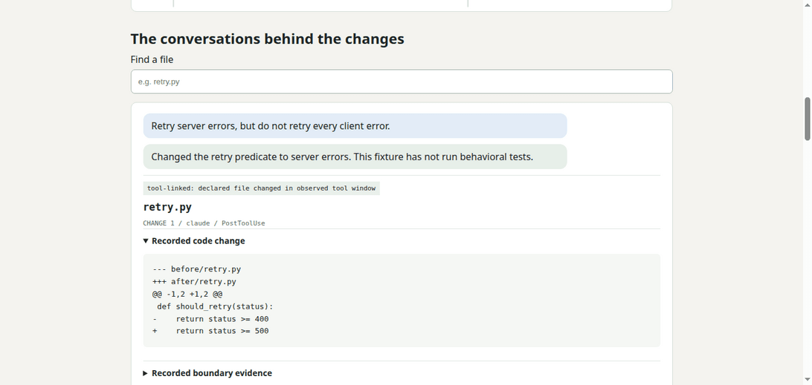

# Sylp provenance: see how your code came to be

Local-first code provenance for AI coding agents. Click a change and see the prompt and tool action behind it. One plugin works with Claude Code, Codex CLI and Cursor CLI. Everything stays on your machine; nothing is uploaded.

## What it looks like




These screenshots are of the synthetic demo fixture ([examples/history.html](examples/history.html)), not a live agent session.

## A real run: fixing a bug in openclaw/openclaw


This is the exported `history.html` for a clone of [openclaw/openclaw](https://github.com/openclaw/openclaw), rendered from the real capture database of six live Claude Code sessions, with the repository name shown under the title. The sessions reproduced and fixed a CLI bug; the graph shows the prompts, the Bash, Read and Edit tool windows around them (including edits to `models-cli.ts` and its test), and the git commits found at render time.

What this screenshot does and does not show:

- It shows the prompt and tool-call record from real sessions.
- It lists 13 recorded changes, none of them a diff of the `models-cli` edits. They come from a later session in which a branch switch changed files, and the page labels them "ambiguous" or "capture gap" rather than tool-linked. The edits to `models-cli.ts` earlier in the graph have no diff here: the repo has over 66000 files and the per-event snapshot stopped at its 2000-file cap, before the recorder diffed declared files past the cap (now fixed and covered by a fixture test; not re-run live on openclaw).
- The commit at the top of the graph was made outside the recorded sessions.
- Token counts and cost are not exposed by host hooks, so none are shown.

The page is one static file written locally. Nothing is uploaded.

## Install

**Claude Code** (native install, no clone):

1. Add the marketplace: `claude plugin marketplace add seanbenhur/sylp`
2. Install the plugin: `claude plugin install sylp-provenance@sylp-provenance`
3. Restart `claude` so the hooks load.

**Cursor CLI** (`agent`): Cursor has no install command for local plugins, so copy the plugin folder once:

1. `git clone https://github.com/seanbenhur/sylp.git ~/sylp` (or `git -C ~/sylp pull` if you already have it)
2. `mkdir -p ~/.cursor/plugins/local && cp -R ~/sylp/plugins/cursor ~/.cursor/plugins/local/sylp-provenance`
3. Restart `agent` so the hooks load.

**Codex CLI**:

1. `git clone https://github.com/seanbenhur/sylp.git ~/sylp` (or `git -C ~/sylp pull` if you already have it)
2. `python3 ~/sylp/install.py --host codex --marketplace`
3. In `codex`, run `/plugins` to enable sylp-provenance and `/hooks` to trust its hooks.

No per-repo setup: once the plugin is enabled, its hooks record every repo you open in that host, each into its own database under `~/.sylp-provenance/repos/`.

### Install with your agent

Paste this prompt into your agent (Claude Code, Cursor or Codex) and it will install the plugin for its own host and verify:

```text
Install the sylp provenance plugin (https://github.com/seanbenhur/sylp) for your host, then verify the install.

1. Detect which host you are and use the matching path:
   - Claude Code: run `claude plugin marketplace add seanbenhur/sylp` then `claude plugin install sylp-provenance@sylp-provenance`.
   - Cursor CLI (agent): `git clone https://github.com/seanbenhur/sylp.git ~/sylp` (or `git -C ~/sylp pull`), then `mkdir -p ~/.cursor/plugins/local && cp -R ~/sylp/plugins/cursor ~/.cursor/plugins/local/sylp-provenance`.
   - Codex CLI: `git clone https://github.com/seanbenhur/sylp.git ~/sylp` (or `git -C ~/sylp pull`), then `python3 ~/sylp/install.py --host codex --marketplace`.
2. Verify without starting any agent session: run `python3 -m unittest discover -s ~/sylp/tests -v` (clone first if needed); 39 checks should pass. For Claude Code, clone the repo anywhere just for the tests. Confirm the plugin files landed where your host expects them.
3. Do NOT run a live recorded prompt as part of this install; that would spend my plan quota. Do not send anything anywhere; the plugin stores data locally and unencrypted, so I will use it in disposable repos only.
4. Tell me exactly what you installed and which files you changed, and remind me to restart the CLI so the hooks load.
```

## Use it, from inside the agent

Open any repo in your agent and work as usual; the hooks record automatically. Then:

- Ask **"why is this line here?"** - the agent answers through the plugin's MCP server from recorded evidence, with an honest "no recorded session" when there is nothing.
- **Dashboard**: `/sylp-provenance:serve` (Claude, Cursor) or the `serve-dashboard` skill (Codex) starts a read-only, localhost-only dashboard that updates live while your agent works.
- **Demo without spending quota**: `/sylp-provenance:demo` builds a synthetic throwaway session and renders it. A pre-rendered example is at [examples/history.html](examples/history.html).
- **PR evidence**: `/sylp-provenance:pr-evidence` drafts a per-file provenance summary; it never opens a PR by itself.

## How it works

Each host's lifecycle hooks send prompt and tool-call boundaries to a small stdlib-Python recorder, which stores them with content-addressed snapshots in SQLite. A change is linked to a prompt only on an exact content match; what cannot be matched is labeled, never guessed. Evidence labels: **tool-linked** (an Edit/Write tool named the file and it changed inside that window), **associated**, **ambiguous**, **unattributed**, **capture gap**.

## Limits

- Fixture-tested only. Hook payload fields differ between hosts; no supported-version floor is claimed.
- Prompts and code can contain secrets. The filename exclusions are not a secret scanner, so do not use this on sensitive repositories yet.
- Captured text is stored unencrypted locally. `recorder.py pause` pauses a repo; to erase history, close the recorder and delete the database under `~/.sylp-provenance`. No secure-erasure guarantee.
- The plugin observes work; it does not execute, resume or control the host agent.

## Tests

Python 3.10+ and git, no dependencies:

```sh
python3 -m unittest discover -s tests -v
```

To verify end to end inside a real host, paste [TESTING-AGENT-PROMPT.md](TESTING-AGENT-PROMPT.md) into your agent; it installs into a throwaway repo, runs one small recorded prompt and reports pass or fail. It states the quota cost first and waits for your go-ahead. The same flow exists as an agent-readable skill at [skills/sylp-provenance-test/SKILL.md](skills/sylp-provenance-test/SKILL.md), with per-host install variants.

License: Apache-2.0.
