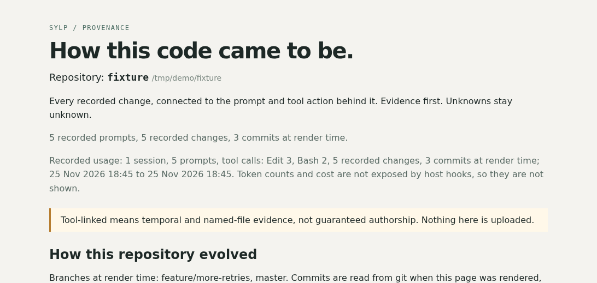
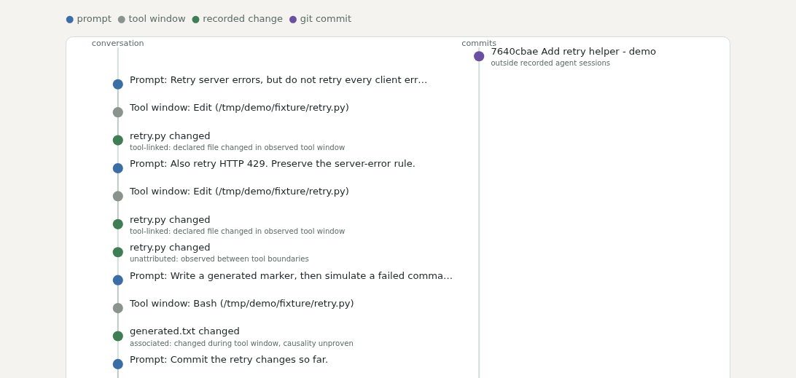
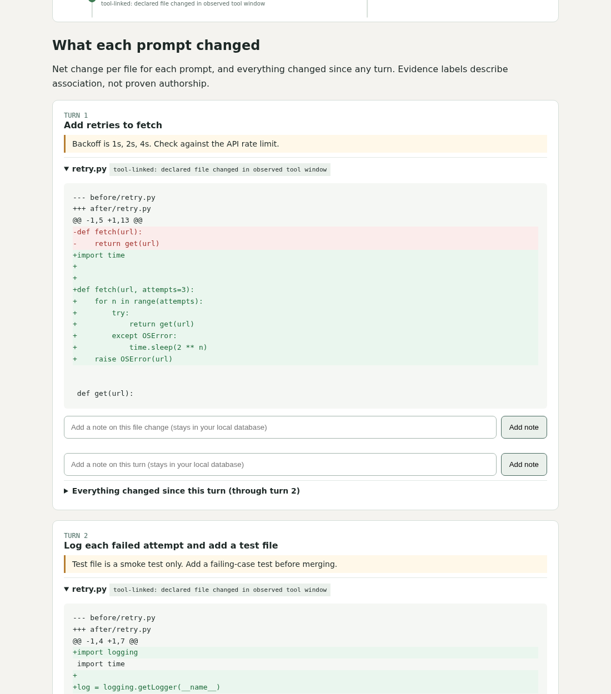
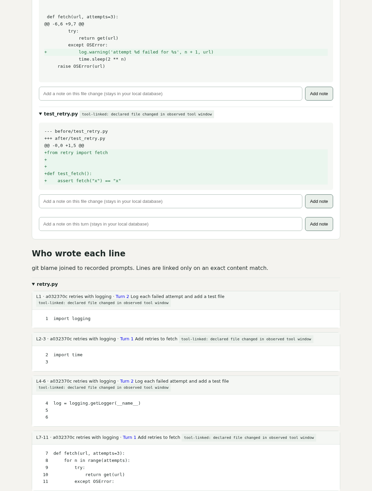
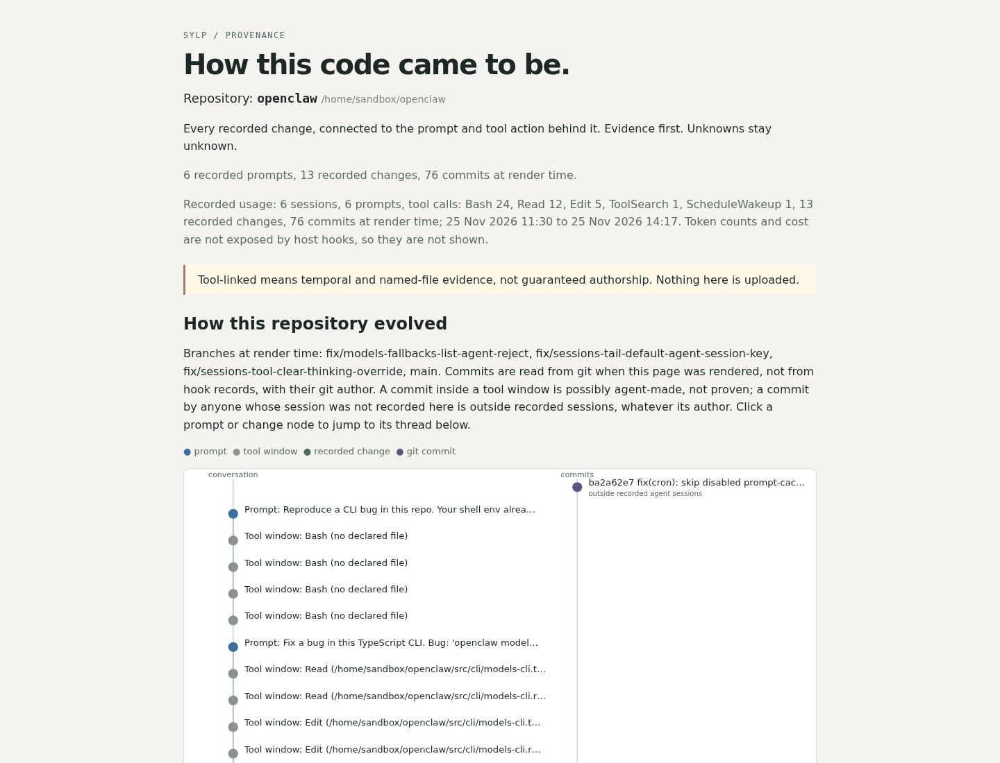

# Sylp provenance: see how your code came to be

Local-first code provenance for AI coding agents. Click a change and see the prompt and tool action behind it. One recorder with adapters for Claude Code, Codex CLI, Cursor CLI and Antigravity. Everything stays on your machine; nothing is uploaded.

## What it looks like










These screenshots are of the synthetic demo fixture ([examples/history.html](examples/history.html)), not a live agent session.

## A real run: fixing a bug in openclaw/openclaw



This is the exported `history.html` for a clone of [openclaw/openclaw](https://github.com/openclaw/openclaw), rendered from the real capture database of six live Claude Code sessions, with the repository name shown under the title. The sessions reproduced and fixed a CLI bug; the graph shows the prompts, the Bash, Read and Edit tool windows around them (including edits to `models-cli.ts` and its test), and the git commits found at render time.

What this screenshot does and does not show:

- It shows the prompt and tool-call record from real sessions.
- It lists 13 recorded changes, none of them a diff of the `models-cli` edits. They come from a later session in which a branch switch changed files, and the page labels them "ambiguous" or "capture gap" rather than tool-linked. The edits to `models-cli.ts` earlier in the graph have no diff here: the repo has over 66000 files and the per-event snapshot stopped at its 2000-file cap, before the recorder diffed declared files past the cap (now fixed and covered by a fixture test; not re-run live on openclaw).
- The commit at the top of the graph was made outside the recorded sessions.
- Token counts and cost are not exposed by host hooks, so none are shown.

The page is one static file written locally. Nothing is uploaded.

## Install

**Claude Code** (native install, no clone):

1. Add the marketplace: `claude plugin marketplace add seanbenhur/sylp`
2. Install the plugin: `claude plugin install sylp-provenance@sylp-provenance`
3. Restart `claude` so the hooks load.

**Cursor CLI** (`agent`): Cursor has no install command for local plugins, so copy the plugin folder once:

1. `git clone https://github.com/seanbenhur/sylp.git ~/sylp` (or `git -C ~/sylp pull` if you already have it)
2. `mkdir -p ~/.cursor/plugins/local && cp -R ~/sylp/plugins/cursor ~/.cursor/plugins/local/sylp-provenance`
3. Restart `agent` so the hooks load.

**Codex CLI**:

1. `git clone https://github.com/seanbenhur/sylp.git ~/sylp` (or `git -C ~/sylp pull` if you already have it)
2. `python3 ~/sylp/install.py --host codex --marketplace`
3. In `codex`, run `/plugins` to enable sylp-provenance and `/hooks` to trust its hooks.

**Antigravity** (CLI, IDE and App share one hook format):

1. `git clone https://github.com/seanbenhur/sylp.git ~/sylp` (or `git -C ~/sylp pull` if you already have it)
2. `agy plugin install ~/sylp/plugins/antigravity`
3. Restart Antigravity so the hooks load.

No per-repo setup: once the plugin is enabled, its hooks record every repo you open in that host, each into its own database under `~/.sylp-provenance/repos/`.

### Install with your agent

Paste this prompt into your agent (Claude Code, Cursor, Codex or Antigravity) and it will install the plugin for its own host and verify:

```text
Install the sylp provenance plugin (https://github.com/seanbenhur/sylp) for your host, then verify the install.

1. Detect which host you are and use the matching path:
   - Claude Code: run `claude plugin marketplace add seanbenhur/sylp` then `claude plugin install sylp-provenance@sylp-provenance`.
   - Cursor CLI (agent): `git clone https://github.com/seanbenhur/sylp.git ~/sylp` (or `git -C ~/sylp pull`), then `mkdir -p ~/.cursor/plugins/local && cp -R ~/sylp/plugins/cursor ~/.cursor/plugins/local/sylp-provenance`.
   - Antigravity: `git clone https://github.com/seanbenhur/sylp.git ~/sylp` (or `git -C ~/sylp pull`), then `agy plugin install ~/sylp/plugins/antigravity`.
   - Codex CLI: `git clone https://github.com/seanbenhur/sylp.git ~/sylp` (or `git -C ~/sylp pull`), then `python3 ~/sylp/install.py --host codex --marketplace`.
2. Verify without starting any agent session: run `python3 -m unittest discover -s ~/sylp/tests -v` (clone first if needed); 62 checks should pass. For Claude Code, clone the repo anywhere just for the tests. Confirm the plugin files landed where your host expects them.
3. Do NOT run a live recorded prompt as part of this install; that would spend my plan quota. Do not send anything anywhere; the plugin stores data locally and unencrypted.
4. Tell me exactly what you installed and which files you changed, and remind me to restart the CLI so the hooks load.
```

## Features

Open any repo in your agent and work as usual; the hooks record automatically. Then:

- **Ask "why is this line here?"** The agent answers through the plugin's MCP server from recorded evidence, with an honest "no recorded session" when there is nothing.
- **History page**: a static `history.html` with a summary, a graph of every change connected to its prompt and tool window, a thread view per change (prompt, agent reply, diff, evidence label), a per-turn diffs view and a blame view. It is one local file; nothing is uploaded.
- **Live dashboard**: `/sylp-provenance:serve` (Claude, Cursor) or the `serve-dashboard` skill (Codex, Antigravity) starts a localhost-only dashboard that updates while your agent works. The same views are there, and you can add notes in it. Note posts need the page's token and a localhost Host and Origin; notes are limited to 2000 characters. Nothing else in the dashboard writes.
- **Per-turn diffs**: the net change to each file per prompt. CLI: `python3 recorder.py turns` (add `--since N` for everything changed since turn N). MCP tool: `turn_diffs`. Also in the history page and dashboard.
- **Line-level blame**: `python3 recorder.py blame path/to/file --repo .` runs git blame and links a line to a recorded prompt only when the line's content exactly matches a recorded change that added it. Other lines say why there is no match. MCP tool: `blame`. Also in the history page and dashboard.
- **Notes**: `python3 recorder.py note add --turn N --text "..."` (or `--change ID`) anchors a note to a turn or change; `note list` shows them. Notes appear in `turns`, `why` and `pr-summary`, and are left out when you pass `--no-prompts`. They stay in the local database.
- **PR evidence**: `/sylp-provenance:pr-evidence` drafts a per-file provenance summary for a pull request; it never opens a PR by itself. `recorder.py pr-summary BASE HEAD --no-prompts` leaves prompt text out.
- **Demo without spending quota**: `/sylp-provenance:demo` builds a synthetic throwaway session and renders it. A pre-rendered example is at [examples/history.html](examples/history.html).
- **Four hosts, one recorder**: Claude Code, Codex CLI, Cursor CLI and Antigravity. See Limits for what has been run live.

## How it works

Each host's lifecycle hooks send prompt and tool-call boundaries to a small stdlib-Python recorder, which stores them with content-addressed snapshots in SQLite. A change is linked to a prompt only on an exact content match; what cannot be matched is labeled, never guessed. Evidence labels: **tool-linked** (an Edit/Write tool named the file and it changed inside that window), **associated**, **ambiguous**, **unattributed**, **capture gap**.

## Limits

- Live-verified on Claude Code only. Codex CLI, Cursor CLI and Antigravity support is tested against fixtures, not yet run in a live session. Hook payload fields differ between hosts; no supported-version floor is claimed.
- Prompts and code can contain secrets. The filename exclusions are not a secret scanner, so do not use this on sensitive repositories yet.
- Captured text is stored unencrypted locally. `recorder.py pause` pauses a repo; to erase history, close the recorder and delete the database under `~/.sylp-provenance`. No secure-erasure guarantee.
- The plugin observes work; it does not execute, resume or control the host agent.

## Tests

Python 3.10+ and git, no dependencies:

```sh
python3 -m unittest discover -s tests -v
```

To verify end to end inside a real host, give your agent the agent-readable skill at [skills/sylp-provenance-test/SKILL.md](skills/sylp-provenance-test/SKILL.md), which has per-host install variants. It installs into a scratch repo, runs one small recorded prompt, reports pass or fail, and states the quota cost first and waits for your go-ahead.

License: Apache-2.0.

