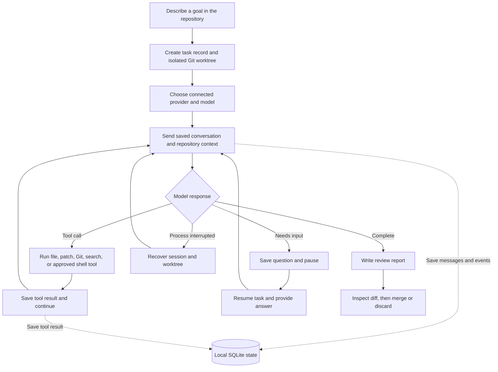

# Everrun

**A standalone coding harness for work that takes more than one prompt.**

Everrun opens an interactive coding session in your repository. It runs its own model-and-tools loop, works in an isolated Git worktree, and saves conversation history and checkpoints locally. Keep chatting as the work evolves, pause and resume later, then review the changes before merging.

## What Everrun does

- **Owns the coding loop.** Everrun sends context to the selected model, dispatches its tool calls, collects results, and continues until the task is complete or needs your input.
- **Surfaces empty model turns.** A completed response with no text or tool calls is recorded with provider diagnostics and retried once before the session pauses.
- **Keeps long tasks resumable.** Task state, messages, tool results, and compacted context checkpoints are stored in SQLite.
- **Remembers across sessions.** At compaction and task completion, Everrun distills durable facts (repository conventions, your preferences, decisions, failure causes) into a local memories table and injects the relevant ones into later sessions. See [Memory](#memory).
- **Prevents duplicate workers.** Everrun locks each session while it is active, including its interactive prompt and tool execution.
- **Recovers interrupted tool turns.** Everrun checkpoints streamed shell output. If a process stops during a tool call, resume includes the recorded result or captured partial output and tells the model to inspect state before considering the action again.
- **Keeps task edits separate.** Every task gets its own Git branch and worktree.
- **Starts from your current checkout.** A new task includes tracked edits and untracked files already in the repository, so it can work on the code you have open before you commit it.
- **Uses models directly.** Connect OpenAI, Anthropic, OpenRouter, or an OpenAI-compatible endpoint. Everrun does not launch Codex CLI or Claude Code.
- **Sandboxes shell commands.** Approved commands can be confined to the task worktree with the rest of the filesystem read-only (bubblewrap on Linux, sandbox-exec on macOS), with optional network cut-off.
- **Speaks MCP.** Stdio Model Context Protocol servers configured in `mcp.json` add their tools to the model loop as `mcp__<server>__<tool>`.
- **Loads local plugins.** Drop a Python file in `~/.everrun/plugins/` or `<repo>/.everrun/plugins/` to add your own tools.
- **Hands back reviewable work.** A completed task includes a report with its goal, criteria, agent summary, diff summary, and provider-reported token usage when available. Everrun does not infer billed cost or merge changes for you.

## Memory

Everrun keeps a small, local, inspectable memory across sessions in the same SQLite database (`memories` table, no external service). Two things happen automatically:

- **Extraction.** When the conversation is compacted and when a task completes, the model distills durable facts - repository conventions, user preferences, decisions and their reasons, root causes of failures - into memories scoped to the repository or to you. Ephemeral task state is skipped on purpose, and repeated facts are deduplicated.
- **Recall.** At task start and resume, the goal and your latest message are searched against saved memories with SQLite FTS5 full-text search (a `LIKE` fallback covers SQLite builds without FTS5), and the top matches are injected into the system prompt with an explicit hint that they are model-extracted and must be verified before use.

Inspect and prune memory any time:

```sh
everrun memory                 # memories for this repository (plus user-scope ones)
everrun memory --all           # everything
everrun memory --search "test command"
everrun memory --forget 12     # delete one memory
```

Set `EVERUN_MEMORY=0` to disable extraction and recall entirely.

### Optional local-model memory (phase 2)

Memory works out of the box with the session provider for extraction and FTS5 for search. Two optional upgrades keep everything local, both off unless configured:

- **Hybrid retrieval.** Point `EVERUN_EMBED_URL` and `EVERUN_EMBED_MODEL` at a local OpenAI-compatible embeddings endpoint (for example Ollama with `nomic-embed-text`). Memory text is embedded as it is saved, and recall fuses keyword and vector ranking with reciprocal rank fusion. Vectors are indexed with [`sqlite-vec`](https://github.com/asg017/sqlite-vec) when that package is installed and scanned in Python otherwise. If the embedding endpoint is unreachable, recall silently falls back to FTS5 only.
- **Local extraction.** Point `EVERUN_MEMORY_EXTRACT_URL` and `EVERUN_MEMORY_EXTRACT_MODEL` at a local OpenAI-compatible chat endpoint (for example Ollama with a small instruct model) to run the extraction pass locally instead of through the session provider. If the local endpoint fails, extraction falls back to the session provider, and if that fails the pass is skipped and recorded as an event - memory never blocks a task.

Honest limits: extraction is model-generated and can be wrong, vague, or stale; deduplication is exact-match after whitespace/case normalization, so paraphrases can accumulate; and retrieval is only as good as the query (your goal plus latest message). Treat recalled memories as leads, not facts, and use `everrun memory --forget` liberally.

## Workflow



## Install

Requires Python 3.11+ and Git.

For a globally available `everrun` command, install it as a uv tool:

```sh
uv tool install --editable .
```

Run this from the Everrun checkout. `uv tool` places the command in its tool bin directory; if your shell still cannot find `everrun`, run `uv tool update-shell` and open a new terminal. To work on Everrun itself, use a project virtual environment instead:

```sh
uv venv --python 3.12 .venv
uv pip install --python .venv/bin/python -e .
source .venv/bin/activate
```

Run the local regression suite from the checkout with:

```sh
.venv/bin/python -m unittest discover -s tests -v
```

## Connect a provider

### Sign in with ChatGPT

Connect Everrun to your ChatGPT account in a browser, then use an eligible ChatGPT plan for model requests. No OpenAI API key is needed for this sign-in path:

```sh
everrun auth login openai
everrun models --provider openai
```

Requests use your ChatGPT plan’s available usage and limits, shared with other apps using that plan. Check or manage app usage in [ChatGPT settings](https://chatgpt.com/#settings/Usage). `everrun auth status` shows whether Everrun is connected through ChatGPT or an API key.

OpenAI API keys are also supported with `everrun auth set openai` or `OPENAI_API_KEY`; API-key requests are billed separately through the OpenAI API account.

### Anthropic

Create an API key in the Anthropic Console and connect it:

```sh
everrun auth set anthropic
everrun models --provider anthropic
```

Claude.ai subscriptions and Anthropic API access are separate products; a Claude subscription does not include Console API usage.

### Google Antigravity & Gemini

Sign in to Google Antigravity in a browser (reusing an existing Antigravity IDE session when one is present), or connect Gemini models with an API key from [Google AI Studio](https://aistudio.google.com/):

```sh
everrun auth login antigravity   # browser OAuth sign-in
everrun auth set gemini          # or: everrun auth set antigravity
everrun models --provider antigravity
```

You can also export `GEMINI_API_KEY`, `ANTIGRAVITY_API_KEY`, or `GOOGLE_API_KEY` in your environment. OAuth sign-ins are routed to Google's Code Assist backend and print each response when the turn completes (no streaming); API-key requests stream from the Gemini Developer API. See [docs/providers.md](docs/providers.md) for the details.

### OpenRouter or another compatible endpoint

```sh
everrun auth set openrouter
everrun models --provider openrouter
```

For an OpenAI-compatible server such as a local model endpoint:

```sh
everrun auth set openai-compatible
everrun models --provider openai-compatible
```

Everrun stores saved credentials in `~/.everrun/auth.json` with owner-only file permissions. You can provide provider keys through environment variables instead.

## Start a task

From the repository you want to work in, start an interactive session:

```sh
cd ~/code/my-project
everrun
```

On first use, Everrun selects the only connected provider automatically. If several providers are connected, it asks which one to use; it then lets you choose a model and remembers both choices. It opens a full-screen terminal session in your repository, where you can start a task or resume one of the saved sessions. Enter sends a message; Ctrl+O adds a line to a multi-line message. Use `/help` to see session commands: `/files` lists repository files, `/diff` reviews task changes, `/switch` moves to another paused session, and `/compact` writes a durable conversation checkpoint. `/exit` pauses and saves; `/done` creates a review report.

In a wide terminal (100+ columns) the UI shows a session rail on the left listing every session for the repository: `●` running, `!` waiting for your input, `❚` paused, `✓` ready for review, with the current session marked by `▸`. Sessions waiting for input are also counted in the header. Press F2 to toggle the rail, and F3 to open a changes pane on the right with the task's live diff summary; both need a session to be bound and hide automatically on narrow terminals. `/switch <id>` pauses the current session and opens another paused one without leaving the full-screen UI.

Tool activity stays out of the way so the transcript reads like a chat: tool calls and their output collapse into a dim `[N tool lines hidden]` placeholder, and F4 toggles the full detail on and off at any point, including for output printed while it was hidden.

For one-shot or automated tasks, start directly:

```sh
everrun run "Add pagination to the projects API" \
  --repo ~/code/my-project \
  --provider openai \
  --model <model-id> \
  --accept "Existing API behavior remains compatible" \
  --accept "Pagination has tests for first, middle, and final pages"
```

Shell commands require approval by default. When a sandbox backend is available, approved commands run confined to the task worktree with the rest of the filesystem read-only; the approval prompt shows the active backend. See [docs/extensions.md](docs/extensions.md) for `EVERUN_SANDBOX` modes and limits. Add `--auto-approve` to let the model run commands without asking each time:

```sh
everrun run "Fix the failing tests" --repo ~/code/my-project \
  --provider anthropic --model <model-id> --auto-approve
```

For a no-argument interactive session, set `EVERUN_AUTO_APPROVE=1` to enable the same behavior. Use it only in a trusted, disposable environment:

```sh
EVERUN_AUTO_APPROVE=1 everrun
```

## Track and resume

```sh
everrun list
everrun status <task-id>
everrun report <task-id>
everrun resume <task-id>
everrun resume <task-id> --answer "Use cursor pagination"
```

In an interactive session, `/exit` pauses and saves the conversation; `/compact` summarizes and checkpoints the current context; `everrun resume <task-id>` reopens it. Ctrl-C also pauses the session. Resume continues from Everrun's saved conversation and worktree; it does not depend on an external coding-agent session.

## Local state and safety

- Task records, events, messages, and checkpoints: `~/.everrun/state.sqlite3`
- Provider credentials: `~/.everrun/auth.json`
- Reports: `~/.everrun/tasks/<task-id>/`
- Task branches and worktrees: `.git/everrun-worktrees/<task-id>` in the repository's common Git directory

Set `EVERUN_HOME` to move Everrun's database, credentials, and reports.

Provider requests allow up to 15 minutes for a response by default. Set `EVERUN_REQUEST_TIMEOUT` to a value from 60 to 3600 seconds to change that limit.

The worktree keeps changes isolated from your current checkout. Shell commands can additionally be sandboxed (see [docs/extensions.md](docs/extensions.md)), but that confinement is best-effort: review commands before approving them, use repositories you trust, and inspect the report and diff before merging. Everrun records model-reported checks but does not independently validate them.

See the [comparison protocol](benchmarks/PROTOCOL.md) for a reproducible Everrun vs. Codex evaluation. Everrun has not been shown to outperform Codex until that protocol has been run and its results published.

## Documentation

- [Architecture](docs/architecture.md) - module map, task lifecycle, the model loop, and interruption recovery
- [Providers](docs/providers.md) - sign-in paths, model listing, and per-provider behavior
- [Configuration](docs/configuration.md) - state layout, environment variables, safety, and development setup
- [Extensions](docs/extensions.md) - shell sandbox, MCP servers, and local plugins

## License

Everrun is licensed under the [Apache License 2.0](LICENSE).
